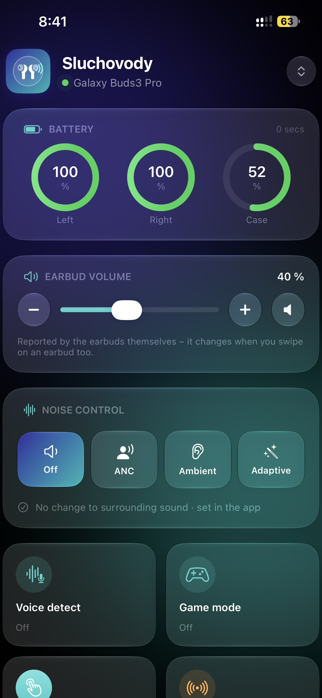
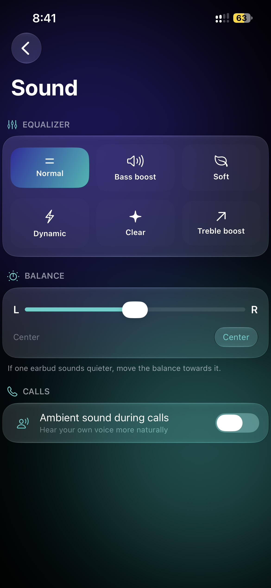
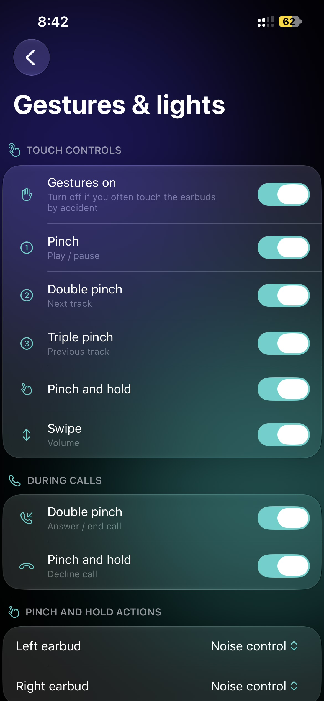
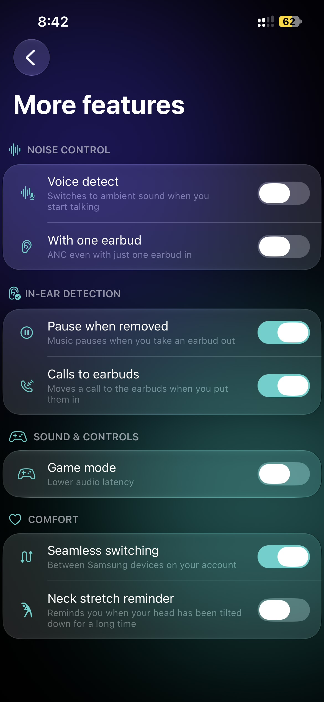

<p align="center">
  
</p>

<h1 align="center">Pinna</h1>

<p align="center">
  Control your Samsung Galaxy Buds from iPhone — noise cancelling, ambient sound, equalizer, gestures and more.<br>
  Native SwiftUI, Liquid Glass design, no account, no network, no tracking.
</p>

<p align="center">
  <a href="https://github.com/ZASAonSK/Pinna/actions/workflows/build.yml"></a>
  
  
  
</p>

<p align="center">
  &nbsp;
  &nbsp;
  &nbsp;
  
</p>
<p align="center"><sub>Home · Sound · Gestures &amp; lights · More features</sub></p>

> **Unofficial project.** Not affiliated with, endorsed by or sponsored by Samsung. *Samsung* and *Galaxy Buds* are trademarks of Samsung Electronics.

## Features

- **Noise control** — Off, ANC, Ambient and Adaptive, plus ANC strength and ambient volume (5 steps on Buds3 Pro).
- **Sound** — 6 equalizer presets, left/right balance, ambient sound during calls, game mode.
- **Gestures & lights** — turn individual pinch gestures on or off, choose touch-and-hold actions and the light style.
- **More** — voice detect, ANC with one earbud, in-ear detection for media and calls, seamless switching, neck stretch reminder, Find My Earbuds.
- **Live battery** for the left and right earbud and the case.
- **Live volume** — changes when you swipe on an earbud, and can be set from the app.
- **Finds your earbuds automatically**, even if you renamed them.
- **Liquid Glass** interface on iOS 26, frosted-material fallback on iOS 16–18.
- **11 languages**, following your phone's language: English, Slovak, Czech, German, Spanish, French, Italian, Polish, Portuguese, Korean, Japanese.

## How it works

Galaxy Buds expose a Bluetooth LE data channel next to their regular Bluetooth audio connection. Pinna writes the same settings messages to it that Samsung's own app sends, and the earbuds apply them. Battery and volume come from standard Bluetooth LE services.

| What | Source | Direction |
| --- | --- | --- |
| Settings (noise mode, EQ, gestures…) | Samsung data channel | iPhone → earbuds |
| Battery (L / R / case) | Samsung broadcast + Battery Service | earbuds → iPhone, live |
| Volume | LE Audio Volume Control Service | both ways, live |
| Model and firmware | Device Information Service | earbuds → iPhone |

**What it can't do:** the earbuds report their current noise mode, in-ear state and settings only over Bluetooth Classic (RFCOMM), which iOS keeps closed to third-party apps. Over Bluetooth LE they stay silent even with notifications enabled, so Pinna shows the values you last set in the app. Details in [docs/PROTOCOL.md](docs/PROTOCOL.md).

## Supported devices

| Device | Status |
| --- | --- |
| Galaxy Buds3 Pro (SM-R630) | **Verified** on real hardware |
| Galaxy Buds, Buds+, Buds Live, Buds Pro, Buds2, Buds2 Pro, Buds FE, Buds Core, Buds3, Buds3 FE, Buds4, Buds4 Pro | Experimental — same messages as Samsung's app, untested. Reports welcome |

Whether a model exposes the Bluetooth LE data channel can only be confirmed on real hardware; the app detects it after connecting and shows battery only if it is missing.

## Install

There is no App Store build. Pinna is distributed as an **unsigned IPA** that you sign with your own Apple ID or developer certificate. Requires **iOS 16 or later**.

Tap a button on your iPhone. It opens the app and adds the source:

<table align="center">
  <tr>
    <td align="center" width="140">
      <a href="https://intradeus.github.io/http-protocol-redirector?r=altstore://source?url=https://raw.githubusercontent.com/ZASAonSK/altstore-repo/main/altstore.json"><br><sub><b>Add to AltStore</b></sub></a>
    </td>
    <td align="center" width="140">
      <a href="https://intradeus.github.io/http-protocol-redirector?r=sidestore://source?url=https://raw.githubusercontent.com/ZASAonSK/altstore-repo/main/altstore.json"><br><sub><b>Add to SideStore</b></sub></a>
    </td>
    <td align="center" width="140">
      <a href="https://intradeus.github.io/http-protocol-redirector?r=feather://source/https://raw.githubusercontent.com/ZASAonSK/altstore-repo/main/altstore.json"><br><sub><b>Add to Feather</b></sub></a>
    </td>
    <td align="center" width="140">
      <a href="https://intradeus.github.io/http-protocol-redirector?r=livecontainer://source?url=https://raw.githubusercontent.com/ZASAonSK/altstore-repo/main/altstore.json"><br><sub><b>Add to LiveContainer</b></sub></a>
    </td>
  </tr>
</table>

The buttons open the app through a small redirect page (`intradeus.github.io/http-protocol-redirector`), because GitHub does not allow links that start with `altstore://`. If a button does nothing, add the source by hand: copy this URL and paste it into **Sources → +** in AltStore, SideStore or Feather.

```
https://raw.githubusercontent.com/ZASAonSK/altstore-repo/main/altstore.json
```

You can also download `Pinna.ipa` from the latest [Release](../../releases/latest) and open it with Sideloadly, TrollStore or any other signing tool. Bluetooth permission is requested on first launch.

## First launch

1. Pair your earbuds in **Settings → Bluetooth** as usual.
2. Open Pinna. If it does not find them on its own, it shows nearby devices — pick yours (renamed earbuds are listed too).
3. Next time it connects automatically.

## Privacy

- No network requests, analytics or third-party SDKs.
- Stored locally on your device: the identifier of the selected earbuds and the settings you last sent. **Device → Forget earbuds** and **Diagnostics → Clear saved settings** delete them.
- The diagnostics log stays on your device unless you share it.

## Build from source

Requirements: macOS with Xcode 26 (older Xcode also builds; the Liquid Glass code is compiled only with Swift 6.2+) and [XcodeGen](https://github.com/yonaskolb/XcodeGen).

```sh
xcodegen generate
xcodebuild -project Pinna.xcodeproj -scheme Pinna \
  -configuration Release -destination 'generic/platform=iOS' \
  CODE_SIGNING_ALLOWED=NO build
```

Run the protocol, model and decoder tests anywhere Swift runs (they only need Foundation):

```sh
swiftc Sources/Protocol/*.swift Sources/App/Localization.swift Tests/main.swift -o /tmp/pinna-tests && /tmp/pinna-tests
```

The app icon is generated without third-party libraries: `python3 tools/make_icon.py Assets.xcassets/AppIcon.appiconset/icon-1024.png`.

## Releasing

Releases are fully automatic. Push to `main` and GitHub Actions tests, builds the IPA, creates the tag and the Release, and adds the new version to the source repository [ZASAonSK/altstore-repo](https://github.com/ZASAonSK/altstore-repo).

- **New version:** change `MARKETING_VERSION` in `project.yml` (and add a `## <version>` section to `CHANGELOG.md`, which becomes the release notes) → release `v1.1.0`.
- **Code change without a version bump:** the revision is numbered automatically → `v1.0.0.1`, `v1.0.0.2`, … so AltStore, SideStore and Feather still offer the update.
- Changes that only touch `*.md`, `docs/`, `LICENSE` or `.gitignore` do not release anything.

## Project layout

| Path | Purpose |
| --- | --- |
| `Sources/Protocol/` | Frame encoding, settings messages, model profiles, broadcast decoder (pure Foundation) |
| `Sources/Bluetooth/BudsController.swift` | CoreBluetooth: finding and connecting the earbuds, battery, volume, sending settings |
| `Sources/Bluetooth/SettingsStore.swift` | Last values sent, per model |
| `Sources/UI/` | Home screen, settings screens, device picker, onboarding, Liquid Glass theme |
| `Sources/Resources/*.lproj` | Translations |
| `Tests/main.swift` | Protocol, model and decoder checks |
| `docs/PROTOCOL.md` | What the earbuds accept and report over Bluetooth LE |

## Translations

UI text goes through `L("English text")`; the English text is the key, so a missing translation falls back to English. To add or fix a language, edit `Sources/Resources/<lang>.lproj/Localizable.strings` (and `InfoPlist.strings` for the Bluetooth permission text). Slovak is native; the other translations were written without native-speaker review, so corrections are very welcome. CI checks that every language has the same keys and placeholders.

## License

[MIT](LICENSE)

## Acknowledgements

- [GalaxyBudsClient](https://github.com/timschneeb/GalaxyBudsClient) by timschneeb and [Gadgetbridge](https://codeberg.org/Freeyourgadget/Gadgetbridge) — reference for the Galaxy Buds message protocol.
- [SamsungGalaxyBuds2Pro](https://github.com/msrk0320/SamsungGalaxyBuds2Pro) by msrk0320 — showed that settings can be written over the Bluetooth LE data channel.

Pinna contains no code from these projects.
